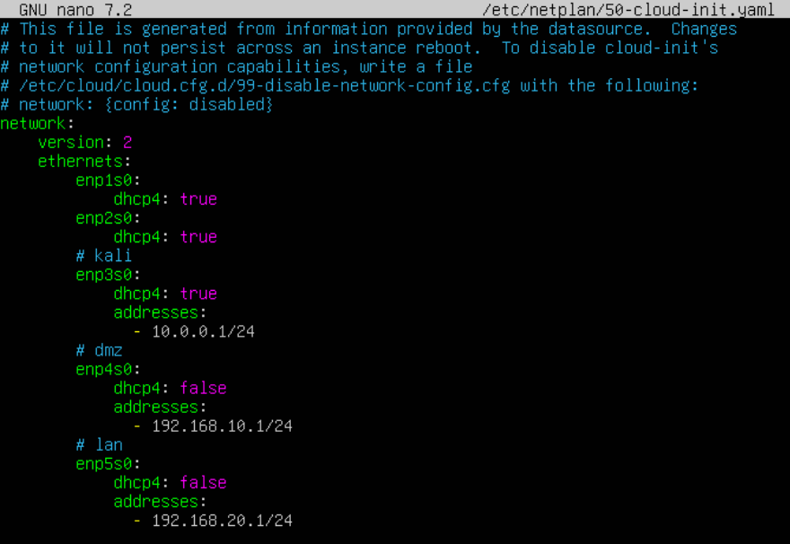

# Operació NordTec
**Daryl Hernández ASIX1B**

## :pushpin: Índice
- [Estado del proyecto](#traffic_light-estado-del-proyecto)
- [RA1: Firewall y red en Linux](#ra1-firewall-y-red-en-linux)
- [RA2: HTML y CSS](#ra2-html-y-css)
- [Incidencias y soluciones](#construction-incidencias-y-soluciones)
- [Decisiones técnicas](#bulb-decisiones-técnicas)
- [Reflexiones técnicas](#memo-reflexiones-técnicas)
- [Tabla de comandos Git](#computer-tabla-de-comandos-git)
- [Guardar en GitHub](#file_folder-guardar-en-github)

## :traffic_light: Estado del proyecto
| RA | Contenido | Estado |
| --- | --- | --- |
| RA1 | Laboratorio firewall: red con netplan y reglas iptables | :white_check_mark: Hecho |
| RA2 | Página HTML + CSS | :white_check_mark: Hecho |
| Documentación | README, revisión y limpieza | :arrows_counterclockwise: En curso |

---

## RA1: Firewall y red en Linux

Laboratorio `Lab_0373_firewall`: una máquina Linux con **cinco tarjetas de red** que actúa como **router y firewall** entre Internet y tres redes internas. Se accede a la máquina por navegador con IsardVDI (noVNC).

### Arquitectura de red
```text
Internet
   │  enp1s0 (DHCP)
┌──┴────────────────────┐
│   lab_0373_firewall   │
└─┬───────┬───────────┬─┘
  │       │           │
enp3s0  enp4s0      enp5s0
10.0.0.1/24   192.168.10.1/24   192.168.20.1/24
 (kali)         (dmz)            (lan)
```

| Interfaz | Red | IP del firewall | Configuración |
| --- | --- | --- | --- |
| `enp1s0` | Salida a Internet | Por DHCP | `dhcp4: true` |
| `enp2s0` | Sin comentario en el archivo | Por DHCP | `dhcp4: true` |
| `enp3s0` | Kali | `10.0.0.1/24` | IP indicada en el archivo |
| `enp4s0` | DMZ (servidor web) | `192.168.10.1/24` | `dhcp4: false` + IP fija |
| `enp5s0` | LAN | `192.168.20.1/24` | `dhcp4: false` + IP fija |

### Configuración de red (netplan)



**Qué es:** el archivo `50-cloud-init.yaml` (en `/etc/netplan/`), que se edita con el editor `nano`. Define las cinco tarjetas de red de la máquina `Lab_0373_firewall`. Tiene 27 líneas.

**Cabecera (comentarios con `#`)**
- El aviso dice que el archivo lo genera **cloud-init** y que los cambios hechos aquí pueden perderse al reiniciar.
- Para evitarlo, se crea `/etc/cloud/cloud.cfg.d/99-disable-network-config.cfg` con el contenido `network: {config: disabled}`.

**Estructura del YAML**
| Línea | Significado |
| --- | --- |
| `network:` | Inicio de la configuración de red |
| `version: 2` | Versión del formato de netplan |
| `ethernets:` | Lista de tarjetas de red cableadas |
| `enp1s0:` ... `enp5s0:` | Nombre de cada tarjeta (hay 5) |
| `dhcp4: true / false` | IP automática por DHCP (`true`) o configurada a mano (`false`) |
| `addresses:` | Lista de IPs fijas, con máscara en formato CIDR |
| `- 10.0.0.1/24` | IP `10.0.0.1` con máscara `255.255.255.0` |

**Qué hace cada interfaz**
| Interfaz | Comentario | Configuración | Para qué sirve |
| --- | --- | --- | --- |
| `enp1s0` | (sin comentario) | `dhcp4: true` | Conexión a Internet: recibe IP por DHCP. Es la interfaz de salida (`-o enp1s0`) en el script |
| `enp2s0` | (sin comentario) | `dhcp4: true` | Otra interfaz con DHCP, que el script no utiliza |
| `enp3s0` | `# kali` | `dhcp4: true` + `10.0.0.1/24` | Red de la máquina Kali (`10.0.0.0/24`) |
| `enp4s0` | `# dmz` | `dhcp4: false` + `192.168.10.1/24` | Zona DMZ, donde está el servidor web |
| `enp5s0` | `# lan` | `dhcp4: false` + `192.168.20.1/24` | Red local interna |

**Detalles importantes**
- El firewall tiene la IP `.1` en cada red interna, así que es la **puerta de enlace** de las máquinas de esa red.
- Las tres redes internas son distintas (`10.0.0.0/24`, `192.168.10.0/24` y `192.168.20.0/24`), por eso el firewall puede enrutar entre ellas.
- `enp3s0` tiene `dhcp4: true` y una IP fija a la vez. Lo normal sería `false`; conviene revisarlo.
- YAML se indenta con **espacios** (nunca tabuladores), y un espacio mal puesto rompe el archivo.

Para aplicar los cambios y comprobarlos:
```bash
sudo netplan apply
ip a
```

---

### Script del firewall (`firewall.sh`)

**Qué es:** el script con las reglas de `iptables` y las instrucciones de la práctica (en catalán):
- *"Posar aquest arxiu en la màquina lab_0373_firewall en /home/isard"*: el script se guarda en esa carpeta.
- *"Executar amb: sudo ./firewall.sh"*: se ejecuta con `sudo`, porque `iptables` necesita permisos de administrador. Si da "Permission denied", antes hay que hacer `chmod +x firewall.sh`.

**Explicación línea a línea**

**1. Cabecera**
| Línea | Significado |
| --- | --- |
| `#!/bin/bash` | Indica que el script se ejecuta con Bash |

**2. Limpiar tablas** (`# netejem taules`)
| Comando | Significado |
| --- | --- |
| `iptables -F` | Borra (*flush*) todas las reglas de la tabla `filter` |
| `iptables -t nat -F` | Borra todas las reglas de la tabla `nat` |
| `iptables -X` | Elimina las cadenas personalizadas |

Sirve para empezar desde cero y que no se acumulen reglas antiguas cada vez que se ejecuta el script.

**3. Política por defecto** (`# política per defecte`)
| Comando | Significado |
| --- | --- |
| `iptables -P INPUT ACCEPT` | Permite el tráfico que llega al propio firewall |
| `iptables -P FORWARD ACCEPT` | Permite el tráfico que pasa de una red a otra |
| `iptables -P OUTPUT ACCEPT` | Permite el tráfico que sale del firewall |

Con las tres en `ACCEPT` **no se bloquea nada**: la política es permisiva.

**4. Salir a Internet** (`# sortir a internet`)
```bash
iptables -t nat -A POSTROUTING -s 192.168.10.0/24 -o enp1s0 -j MASQUERADE
iptables -t nat -A POSTROUTING -s 192.168.20.0/24 -o enp1s0 -j MASQUERADE
iptables -t nat -A POSTROUTING -s 10.0.0.0/24 -o enp1s0 -j MASQUERADE
```
- `-t nat`: tabla de NAT.
- `-A POSTROUTING`: añade la regla en la cadena que se aplica **justo antes de que el paquete salga**.
- `-s 192.168.10.0/24`: solo para paquetes cuyo origen es esa red (DMZ). Las otras dos líneas hacen lo mismo con la LAN y con Kali.
- `-o enp1s0`: solo para paquetes que salen por la interfaz de Internet.
- `-j MASQUERADE`: cambia la IP de origen privada por la IP de `enp1s0`.

Las IPs privadas no se pueden usar en Internet. Con `MASQUERADE`, las tres redes internas salen con la IP del firewall, y las respuestas vuelven al equipo correcto.

**5. Publicar el servidor web (DNAT)** (`# publicar el servidor web`)
```bash
iptables -t nat -A PREROUTING -i enp3s0 -p tcp --dport 80 -j DNAT --to-destination 192.168.10.10
iptables -t nat -A PREROUTING -i enp3s0 -p tcp -d 10.0.0.1 --dport 80 -j DNAT --to-destination 192.168.10.10
```
- `-A PREROUTING`: se aplica **nada más llegar el paquete**, antes de decidir a dónde enrutarlo.
- `-i enp3s0`: solo para tráfico que entra por la interfaz de la red Kali.
- `-p tcp --dport 80`: protocolo TCP al puerto 80 (HTTP, la web).
- `-d 10.0.0.1` (segunda regla): además, solo si el destino es la IP del firewall en esa red.
- `-j DNAT --to-destination 192.168.10.10`: cambia la IP de destino por `192.168.10.10`, que es el servidor web, dentro de la DMZ (`192.168.10.0/24`).

**Qué hace cada regla**
| Regla | Qué captura | Qué hace |
| --- | --- | --- |
| 1ª | Cualquier tráfico TCP al puerto 80 que entra por `enp3s0` | Lo redirige al servidor web `192.168.10.10` |
| 2ª | Solo el tráfico TCP al puerto 80 que entra por `enp3s0` **y** va dirigido a `10.0.0.1` | Lo redirige al mismo servidor `192.168.10.10` |

Las dos reglas llevan al mismo destino. La segunda es más concreta, porque solo actúa si se pide la web a la IP del firewall (`10.0.0.1`).

Así, cuando Kali pide la web a `10.0.0.1`, el firewall redirige la petición a `192.168.10.10`. Kali ve una sola IP y el servidor sigue dentro de la DMZ.

**Conceptos clave**
| Concepto | Significado |
| --- | --- |
| `-A` | Añadir una regla (*append*) |
| `-s` / `-d` | Origen (*source*) / destino (*destination*) |
| `-i` / `-o` | Interfaz de entrada / de salida |
| `-j` | Qué hacer con el paquete (*jump*): `ACCEPT`, `MASQUERADE`, `DNAT`... |
| **SNAT / MASQUERADE** | Cambia la IP de origen para que las redes privadas salgan a Internet |
| **DNAT** | Cambia la IP de destino para publicar un servidor interno |

**Resumen del flujo**
```text
Salir a Internet:  máquina interna → firewall (POSTROUTING + MASQUERADE) → enp1s0 → Internet
Publicar la web:   Kali → 10.0.0.1:80 → firewall (PREROUTING + DNAT) → servidor web (DMZ)
```

**Cómo comprobar que funciona**
```bash
sudo ./firewall.sh                # ejecutar el script
sudo iptables -t nat -L -n -v     # ver las reglas de NAT cargadas
cat /proc/sys/net/ipv4/ip_forward # debe dar 1 para que reenvíe tráfico
```
- Desde una máquina interna: `ping 8.8.8.8` para probar la salida a Internet.
- Desde Kali: abrir `http://10.0.0.1` para probar la web publicada.

> [!WARNING]
> Con las tres políticas en `ACCEPT` el firewall todavía no filtra nada: solo hace NAT. Para que proteja, habría que cambiar `FORWARD` a `DROP` y permitir solo el tráfico necesario.

> [!NOTE]
> Para que la máquina reenvíe tráfico entre redes debe estar activado el reenvío de IP (`net.ipv4.ip_forward=1`). Si `ip_forward` da `0`, no reenviará tráfico aunque las reglas estén bien.

---

## RA2: HTML y CSS

### Arquitectura
```text
LDM_html/
├── ejercicio1.html
├── css/
│   └── style.css
├── img/
│   └── gta.jpg
└── README.md
```

#### Estructura de la página
| Etiqueta | Para qué la uso |
| --- | --- |
| `<header>` | Cabecera con el título y el subtítulo |
| `<nav>` | Menú con enlaces internos (`href="#id"`) a cada sección |
| `<main>` | Contenido principal de la página |
| `<section>` | Cada bloque temático (colores, selectores, caja, tabla, formulario) |
| `<aside>` | Barra lateral con contenido relacionado |
| `<article>` | Tarjeta independiente dentro del aside |
| `<footer>` | Pie de página con copyright y enlace "Volver arriba" |
| `<table>` | Tabla con `<caption>`, `<thead>`, `<tbody>` y `colspan` |
| `<form>` | Formulario con `input`, `select`, `textarea` y `label` |

#### Contenido de cada sección
1. **Colores**: nombre, hexadecimal, RGB, RGBA, HSL y degradado.
2. **Selectores**: etiqueta, clase, id, descendiente, hijo directo, atributo, pseudoclases y pseudoelementos.
3. **Modelo de caja**: `padding`, `border`, `margin`, `display`, `position` y flexbox.
4. **Tabla**: horario con filas alternas y `hover`.
5. **Formulario**: campos con estilo y `:focus`.

### Explicación del HTML

HTML (*HyperText Markup Language*) es un lenguaje de **marcas**: se usan etiquetas para indicar **qué es** cada parte del contenido (un título, un párrafo, un enlace...). No dice cómo se ve; de eso se encarga el CSS.

#### 1. Anatomía de una etiqueta
```html
<a href="https://www.w3.org" target="_blank">Enlace</a>
```
| Parte | Ejemplo | Significado |
| --- | --- | --- |
| Etiqueta de apertura | `<a>` | Dónde empieza el elemento |
| Atributos | `href="..."`, `target="_blank"` | Información extra (`nombre="valor"`) |
| Contenido | `Enlace` | Lo que se ve en la página |
| Etiqueta de cierre | `</a>` | Dónde termina el elemento |

Algunas etiquetas **no tienen cierre** porque no contienen nada: ``, `<meta>`, `<link>`, `<input>`, `<br>`.

#### 2. Estructura básica de un documento
```html
<!DOCTYPE html>
<html lang="es">
<head>
  <!-- información que NO se ve en la página -->
</head>
<body>
  <!-- todo lo que SÍ se ve en la página -->
</body>
</html>
```
- `<!DOCTYPE html>`: indica que el documento es HTML5.
- `<html lang="es">`: raíz del documento; `lang` indica el idioma.
- `<head>`: información sobre la página (título, codificación, estilos).
- `<body>`: el contenido visible.

#### 3. El `<head>`
| Etiqueta | Para qué sirve |
| --- | --- |
| `<meta charset="UTF-8">` | Permite escribir tildes y la ñ sin que salgan caracteres raros |
| `<meta name="viewport" ...>` | Hace que la página se adapte al ancho del móvil |
| `<title>` | Texto que aparece en la pestaña del navegador |
| `<link rel="stylesheet" href="css/style.css">` | Conecta el archivo CSS externo |

#### 4. Comentarios
```html
<!-- Esto no se muestra en la página -->
```
Sirven para explicar el código y dividirlo en bloques.

#### 5. Estructura semántica de la página
| Etiqueta | Zona |
| --- | --- |
| `<header>` | Cabecera con título y subtítulo |
| `<nav>` | Menú de navegación |
| `<main>` | Contenido principal (solo uno por página) |
| `<section>` | Bloque temático con su propio título |
| `<aside>` | Contenido secundario (barra lateral) |
| `<article>` | Contenido independiente (la tarjeta) |
| `<footer>` | Pie de página |
| `<div>` | Caja genérica sin significado, para agrupar |

#### 6. Textos
```html
<h1>Título principal</h1>
<h2>Subtítulo</h2>
<p>Un párrafo con <b>negrita</b> y <code>código</code>.</p>
```
- `<h1>` a `<h6>`: títulos por nivel de importancia. Lo normal es **un solo `<h1>`**.
- `<p>`: párrafo. `<b>`: negrita. `<code>`: código. `<br>`: salto de línea.
- `<span>`: etiqueta en línea sin significado, para dar estilo a un trozo de texto.

#### 7. Enlaces
```html
<a href="https://www.w3.org" target="_blank">Enlace externo</a>
<a href="#tabla">Enlace interno</a>
```
- **Externo**: `href` con la dirección completa. `target="_blank"` lo abre en otra pestaña.
- **Interno**: `href="#id"` salta al elemento que tenga ese `id`.

#### 8. Imágenes
```html

```
- `src`: ruta de la imagen.
- `alt`: texto alternativo, para cuando la imagen no carga y para lectores de pantalla.
- `width`: ancho en píxeles.

#### 9. Listas
```html
<ul>
  <li>Elemento 1</li>
  <li>Elemento 2</li>
</ul>
```
- `<ul>`: lista con viñetas. `<ol>`: lista numerada. `<li>`: cada elemento.
- El menú de la página es una lista de enlaces dentro de un `<nav>`.

#### 10. Tablas
```html
<table>
  <caption>Horario de ejemplo</caption>
  <thead>
    <tr><th>Hora</th><th>Lunes</th></tr>
  </thead>
  <tbody>
    <tr><td>8:00</td><td>Lenguaje de marcas</td></tr>
    <tr><td colspan="2">Patio</td></tr>
  </tbody>
</table>
```
| Etiqueta | Significado |
| --- | --- |
| `<table>` | La tabla entera |
| `<caption>` | Título de la tabla |
| `<thead>` / `<tbody>` | Cabecera y cuerpo |
| `<tr>` | Una fila |
| `<th>` / `<td>` | Celda de cabecera / de datos |
| `colspan` | La celda ocupa varias columnas |

#### 11. Formularios
```html
<form action="#" method="get">
  <label for="nombre">Nombre</label>
  <input type="text" id="nombre" name="nombre" placeholder="Escribe tu nombre" required>
  <button type="submit">Enviar</button>
</form>
```
- `<form>`: contenedor. `action` indica a dónde se envían los datos y `method` cómo (`get` o `post`).
- `<label for="nombre">`: su `for` debe coincidir con el `id` del campo.
- `<input type="...">`: campo de entrada (`text`, `email`...).
- `<select>` + `<option>`: lista desplegable. `<textarea>`: texto de varias líneas.
- `placeholder`: texto de ayuda. `required`: campo obligatorio.

#### 12. Atributos `class` e `id`
```html
<p class="destacado">Se puede repetir en varios elementos</p>
<p id="parrafo-unico">Solo puede haber uno con este id</p>
```
Son el puente con el CSS: `.destacado` para una clase y `#parrafo-unico` para un id.

#### 13. Caracteres especiales
| Entidad | Resultado |
| --- | --- |
| `&gt;` | `>` |
| `&lt;` | `<` |
| `&copy;` | © |

#### 14. Anidamiento
```html
<!-- Correcto -->
<p>Texto con <b>negrita</b></p>

<!-- Incorrecto: se cierran en orden cruzado -->
<p>Texto con <b>negrita</p></b>
```

### Configuración del proyecto HTML
1. Crear la carpeta del proyecto y abrirla en VS Code.
2. Crear `ejercicio1.html` y las carpetas `css/` e `img/`.
3. Enlazar la hoja de estilos dentro del `<head>`:
   ```html
   <link rel="stylesheet" href="css/style.css">
   ```
4. Declarar el idioma y la codificación:
   ```html
   <html lang="es">
   <meta charset="UTF-8">
   <meta name="viewport" content="width=device-width, initial-scale=1.0">
   ```
5. Visualizar la página con **Live Server** (clic derecho en `ejercicio1.html` → *Open with Live Server*).

---

## :construction: Incidencias y soluciones
| RA | Mensaje de error :bangbang: | Cuándo :question: | Causa :mag_right: | Solución :o: | Detectada :detective: |
| --- | --- | --- | --- | --- | --- |
| RA1 | `Permission denied` | Al ejecutar `./firewall.sh` | El script no tiene permiso de ejecución | `chmod +x firewall.sh` y ejecutar con `sudo` | 24/11/2026 |
| RA1 | Error al aplicar netplan | Al ejecutar `sudo netplan apply` | Mala indentación en el YAML | Revisar los espacios (sin tabuladores) | 24/11/2026 |
| RA2 | La página se ve sin estilos | Al abrir `ejercicio1.html` | La ruta del `href` no coincide con la del CSS | Comprobar que la ruta es `css/style.css` | 24/11/2026 |
| RA2 | La imagen no aparece | Al cargar la página | Ruta o nombre incorrecto (`img/gta.jpg`) | Revisar mayúsculas, extensión y carpeta | 24/11/2026 |

> [!NOTE]
> Las filas son ejemplos de errores típicos. Cámbialas por los que hayas tenido de verdad.

## :bulb: Decisiones técnicas
**RA1**
- **Una interfaz por red** (kali, dmz, lan) para separar el tráfico y poder controlarlo en el firewall.
- **IP fija en las redes internas** (`dhcp4: false`), para que el firewall siempre tenga la misma dirección como puerta de enlace.
- **MASQUERADE** para que las redes privadas salgan a Internet con una sola IP.
- **DNAT en el puerto 80** para publicar el servidor web de la DMZ sin exponer toda la red.
- **Script `firewall.sh`**, para repetir la configuración sin escribir cada regla a mano.

**RA2**
- **HTML semántico** (`header`, `nav`, `main`, `aside`, `footer`) en lugar de solo `div`.
- **CSS en un archivo externo**, para separar contenido y presentación.
- **Variables CSS** en `:root`: cambiando un color se actualiza toda la página.
- **CSS Grid** para la estructura principal y **Flexbox** para el menú y las demos.
- **Media query** (`max-width: 768px`) para adaptar la página a móviles.

## :memo: Reflexiones técnicas

**Lo que he aprendido**
- Vengo de SMIX, donde vimos sobre todo hardware y redes, así que el RA1 me resultó más familiar que el RA2.
- RA1: un firewall también puede hacer de router, con NAT para salir a Internet y para publicar un servidor.
- RA1: el orden de las reglas de `iptables` y la indentación del YAML importan mucho.
- RA2: HTML no es un lenguaje de programación, sino de **marcas**, y el CSS va separado.
- RA2: `class` se puede repetir, `id` es único, y las rutas deben ser exactas.

**Lo que más me ha costado**
- Entender la diferencia entre `PREROUTING` y `POSTROUTING`.
- El modelo de caja (`padding`, `border`, `margin`) y `position: absolute`.
- Saber cuándo usar Grid y cuándo Flexbox.

**Qué mejoraría**
- RA1: poner las políticas en `DROP` y permitir solo el tráfico necesario.
- RA2: pasar los estilos en línea (`style="..."`) al CSS y validar el código en el [validador de W3C](https://validator.w3.org/).
- Rehacer los dos ejercicios sin copiar, para comprobar que lo he entendido.

## :computer: Tabla de comandos Git
| Comando | ¿Qué hace? |
| --- | --- |
| `git --version` | Muestra la versión de Git instalada |
| `git init` | Crea un repositorio Git vacío |
| `git clone <url>` | Copia un repositorio remoto en tu equipo |
| `git status` | Muestra el estado actual del repositorio |
| `git add <archivo>` / `git add .` | Prepara los cambios para guardarlos |
| `git commit -m "mensaje"` | Guarda los cambios preparados con un mensaje |
| `git push` | Sube los cambios a GitHub |
| `git pull` | Descarga los cambios más recientes |
| `git log --oneline` | Muestra el historial resumido de commits |

## :file_folder: Guardar en GitHub
1. Guardar el archivo: `Ctrl + S`
2. Preparar los cambios: `git add README.md` (o `git add .` para todo)
3. Guardar la versión: `git commit -m "Describe lo que has cambiado"`
4. Subir a GitHub: `git push` (la primera vez: `git push -u origin main`)